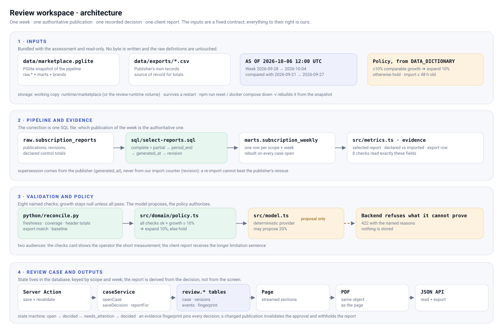

# Solution notes

## What this is

A weekly review workspace for marketplace operations. For one brand and marketplace it shows the
week that operations could not reconcile, proves which publisher report is authoritative, records the
decision the evidence supports, and produces the client report. Every number comes from the bundled
data; the workflow never hardcodes a figure, an id or a brand.

## Run it

```sh
docker compose up --build      # then open http://localhost:3000
```

State (decisions, versions, audit events) lives in the `review-runtime` volume:
`docker compose restart` reopens it, `docker compose down -v` starts again from the bundled snapshot.

Optional overrides live in [`.env.example`](.env.example): `ASSESSMENT_LATENCY_MS` (demo latency),
`ASSESSMENT_EXPORTS_DIR` (run against another dataset), `PYTHON` (interpreter path). Copy it to
`.env.local`, or export the variables; the defaults need nothing.

Without Docker:

```sh
npm ci && npm run setup && npm run dev      # http://localhost:3000
npm run verify                              # prettier + tsc + 15 TS tests + 9 Python tests
```

## The four operations the brief asks for

| Brief requirement | Where it is | How to check it |
| --- | --- | --- |
| Open a case for any brand and marketplace, investigate the evidence, validate a correction | `/` lists the 7 scopes; the case page shows the numbers, then "Where the numbers came from" | Open `cedar-coast/US`: 24,750 was counted before, 8,400 is counted now |
| Save a decision with scope, sources, calculation, reason and limitations; survive a restart; reopen | "Record the decision" rail (Server Action) | Save, `docker compose restart`, reload: the version is still there |
| Block unsupported approvals in the backend | `saveDecision` + `evaluateDecision` | The API refuses with `422` even when the UI is bypassed: `curl -X POST .../api/case/decision -d '{"outcome":"expand_promotion",...}'` |
| Generate the client report from the validated state; revalidate when evidence changes | Report card (server-rendered) with a PDF download | Save, then change the evidence (see tests): the case moves to `needs_attention` and the report refuses the old approval |

## The correction

The weekly mart is built from `sql/select-reports.sql`. **As delivered in the `starter` commit** that
query ranked reports only by status and kept every row tied at the top, so a week the publisher
reissued three times was counted three times; and it broke remaining ties with our own import
sequence, so a re-imported stale publication outranked the publisher's correction. Nothing in this
section refers to an earlier version of this solution: it is the code we were given, and
`git diff starter -- sql/select-reports.sql` is the whole change.

| Scope | As delivered | Now | Publisher current report |
| --- | --- | --- | --- |
| cedar-coast / US | 24,750 (three publications added) — "+217.31% growth" | **8,400**, partial through 2026-10-02, growth **not comparable** | `US-cedar-coast-2026-09-28-g3` |
| harbor-pantry / CA | 11,780 (a re-import of g3 outranked the reissue g4) — "+227.22%" | **3,780**, growth **5.00%** | `CA-harbor-pantry-2026-09-28-g4` |
| moss-trail / US | previous week 5,213 from a truncated import — "+17.02%" | growth **not comparable** (100 of 120 offers imported) | `US-moss-trail-2026-09-21-g3` |
| lumen-home / CA | 2,800 | **2,800**, growth **12.00%** → expansion supported | `CA-lumen-home-2026-09-28-g3` |

Selection order, encoded once in SQL: complete beats partial → wider `period_end` wins → the
publisher's newest `generated_at` wins (this is the correction: `revision` is our import counter, not
the publisher's) → `revision`, `extracted_at`, `report_id` break exact ties.

## Why each change was made

Every change below answers something the delivered starter did, not an earlier version of this
solution. `git diff starter..HEAD` is the whole story.

| Change | Why | Where to see it |
| --- | --- | --- |
| `sql/select-reports.sql` selects one publication by publisher precedence | the delivered query kept every row tied at the top, so three publications of one week were summed (24,750 instead of 8,400), and the import counter could outrank the publisher's reissue | `git diff starter -- sql/select-reports.sql`, the "Where the numbers came from" table, `tests/precedence.test.ts` |
| `python/reconcile.py` runs eight checks and only then computes growth | quality only looked at import age, so a partial week and a truncated import still reported "ready" | cedar and moss-trail show no growth figure; the checks card shows the measurements |
| `src/domain/policy.ts` owns the decision | the starter validated the shape of the provider output (0–25%), so a 20% suggestion taken from a note passed validation | `422` with the named reasons; the recommendation text says only 10% is authorized |
| `src/metrics.ts` carries the selected report, the publisher control totals and the export | without them nothing can be compared against the source of record | the detail line of each check |
| `src/server/*` plus the Server Action add case storage and the mutation path | the brief requires backend-owned state that survives a restart and refuses decisions; the starter had no persistence at all | save, `docker compose restart`, reload: the version is still there |
| `app/*` adds the Next.js workspace | the brief requires a React + TypeScript visual artifact; the delivered starter was a CLI only | the interface itself |
| Prettier, stricter TypeScript, the domain split | reviewable code and fewer hidden assumptions; the vocabulary module also generates the database `CHECK` constraints, so schema and code cannot drift | `npm run verify`, `git diff starter -- tsconfig.json` |
| PDF export, decision history, demo latency | requested while reviewing the result; the export goes beyond the brief and is labelled as such | report card, history card, `ASSESSMENT_LATENCY_MS` |

## How the evidence is verified

`python/reconcile.py` runs eight named checks. Growth is computed only when all of them pass;
otherwise it is `null` and the decision is refused.

| Check | Compares |
| --- | --- |
| `import_fresh` | import age against the fixed clock (48 h limit) |
| `current_complete`, `previous_complete` | report status and coverage end against the week that was requested |
| `current_reconciled`, `previous_reconciled` | offers and subscriptions we imported against the publisher's control totals in the report header |
| `current_matches_export`, `previous_matches_export` | the selected publication and its total against `data/exports/` (the source of record) |
| `baseline_available` | previous week > 0, otherwise the percentage is undefined |

The policy (`src/domain/policy.ts`) turns those checks into the only two outcomes: expand by 10% on
proven comparable growth of at least 10%, otherwise hold. The model provider still proposes in
`src/model.ts` (its 20% suggestion from an operational note is recorded in the trace), but it cannot
authorize anything.

## Architecture



The same diagram in Mermaid, which renders on the repository page: [`docs/architecture.md`](docs/architecture.md).

The same flow in words, band by band:

1. **Inputs** — the bundled PGlite snapshot, the publisher exports (source of record) and the policy
   numbers documented in `DATA_DICTIONARY.md`. Read-only.
2. **Pipeline and evidence** — `raw.*` → `sql/select-reports.sql` (one authoritative publication per
   week) → `marts.subscription_weekly` → `src/metrics.ts`, which carries the selected report, the
   publisher control totals and the export row.
3. **Validation and policy** — `python/reconcile.py` runs the eight checks; `src/domain/policy.ts`
   turns the result into the only two outcomes. `src/model.ts` proposes and cannot authorize.
4. **Review case and outputs** — `caseService` writes versioned decisions into the `review` tables, the
   Server Action saves and revalidates, and the page, the PDF and the JSON API all read the same object.

```
app/                  Next.js App Router: server components read the case, one Server Action mutates
  _actions/decision.ts        the mutation path (save + revalidate)
  api/case{,/decision,/report,/report/export}
src/server/           caseService (openCase, saveDecision, reportFor), reviewStore, exports reader
src/domain/           pure: vocabulary, policy, candidates, evidence diff, client report
python/reconcile.py   evidence checks, stdio JSON only
sql/select-reports.sql  the correction
```

- **Data flow**: `raw.*` → `select-reports.sql` → `marts.subscription_weekly` → evidence (+ publisher
  exports) → Python checks → policy verdict → case service → page, the PDF download and the JSON API.
- **Persistence**: new tables in a `review` schema on the local PGlite working copy
  (`review_case`, `decision`, `event`). Versions are append-only, each one stores the scope, source
  report ids, calculation, reason, derived limitations and an evidence fingerprint. The bundled
  snapshot, the exports and the `raw.*` definitions are untouched.
- **Transitions**: `open → decided → needs_attention → decided`. Saving re-derives the evidence, so a
  refused decision stores nothing. When the fingerprint of the stored decision no longer matches,
  the case requires attention and the report is withheld instead of reusing the old approval.
- **Validation boundaries**: request shape at the route/action (`400`), policy on freshly derived
  evidence (`422`), evidence fitness in Python, record integrity in the database (`CHECK`
  constraints generated from the same vocabulary the code uses).

## Interaction and visual decisions

- Numbers before prose: four metric tiles open the case, the outcome is one sentence derived from the
  failing check, and the long evidence sits in collapsed disclosures that open themselves only when
  something needs attention.
- **Two views, two audiences.** Opening a case lands on the **Client report**: the figures, the
  decision, its caveats and the next step, plus the decision controls. The investigation material —
  which publications exist for the week, what the exports say, the eight checks, the decision history —
  lives behind a **Review** tab, where an operator or an auditor can inspect it. The client report and
  its PDF carry no internal ids: only a line stating that the figures were verified against the
  publisher's export.
- The decision form is a sticky rail, and the report is rendered by the server as part of the case (a
  labelled draft before any decision). The PDF is drawn from the same object with the same hierarchy —
  header band, status chip, three figures, decision, caveats, next step — so the screen and the file
  cannot disagree.
- Decision history lists every version with its figures, reason, sources, limitations and evidence
  fingerprint, with the current version tagged.
- Hover and focus-visible states on every clickable surface, `prefers-reduced-motion` honoured, and
  the layout checked at 1440 px and 390 px.
- The case streams in sections (navigation, summary, evidence, checks, history, decision rail,
  report). Each one has its own skeleton, so a slow part never blanks the page. Set
  `ASSESSMENT_LATENCY_MS=800` to stagger the sections and see every loading state; it is off by
  default and cannot change a figure.

## Tests

| File | Proves |
| --- | --- |
| `tests/precedence.test.ts` | one publication per mart row, mart equals the selected report's offers, every deviation from the export explained by a measured ingestion gap, plus the three named cases |
| `tests/test_reconciliation.py` | growth refused for partial coverage, truncated imports, a missing baseline and an export disagreement; every check is reported |
| `tests/review-case.test.ts` | a decision survives stop/restart; the backend refuses an unsupported expansion; a publisher reissue moves the case to `needs_attention` and the old approval is not reused; a report the publisher never exported cannot be approved |
| `tests/export-report.test.ts` | the PDF is a real document whose text carries the figures, the decision and the next step; file names mark drafts |
| `tests/analyst.test.ts`, first three Python tests | the supplied starter behaviour still works |

To see the loading states: `ASSESSMENT_LATENCY_MS=800 docker compose up --build` and open a case.

## Data, schema and scripts: what changed and who owns it

The brief fixes `data/` and the `raw.*` definitions, and asks for review state in separate tables with
documented ownership. `git diff starter..HEAD -- data/ sql/schema.sql` is empty: the bundled snapshot,
the publisher exports and the raw/marts definitions are byte-for-byte as delivered.

| Layer | Owner | Lifecycle |
| --- | --- | --- |
| `data/marketplace.pglite`, `data/exports/*.csv` | the exercise, read-only contract | never written by the app; the exports are read at runtime and can be redirected with `ASSESSMENT_EXPORTS_DIR` |
| `raw.*` | the source contract | read-only for the app |
| `marts.subscription_weekly` | the app, derived | rebuilt from `sql/select-reports.sql` on every case open, inside one transaction (`src/database.ts`) |
| `review.review_case`, `review.decision`, `review.event` | the app | created at boot by `migrate()` in `src/server/db.ts` with `CREATE ... IF NOT EXISTS`; they live in the working copy `.runtime/marketplace` (or the `review-runtime` volume), survive a restart, and are dropped by `npm run reset` / `docker compose down -v` |

Changed scripts and queries are listed with their reasons in "Why each change was made", and
`sql/select-reports.sql` carries the selection rule as a comment next to the code. The audit trail is
the git history: 17 commits on top of the preserved `starter` tag, each with a Conventional Commit
message, inside the repository that came in the ZIP. No new repository was created.

## Limitations and unfinished work

- The truncated moss-trail import is detected and blocks the decision; it is not repaired (the fixture
  is immutable and re-fetching from a publisher is out of scope).
- One case per scope and week, fixed to the reporting week the brief defines. No case list, comments,
  authentication or deployment, as the brief excludes them.
- The PDF export was added on request and is outside the brief's requirements; it draws the same
  object as the page, so it cannot drift.
- No automated browser test in the repository: the interface was verified with real browser captures
  during development, and the server behaviour is covered by the tests above.
- `reconciliationDelta` was redefined to "counted subscriptions minus the publisher declared total",
  which is the gap that matters; the starter field compared the figure against itself.

## Time spent

Approximately 150 minutes of reading, investigation, implementation, tests and these notes. The
3-minute narrated video is recorded separately and is not part of this estimate.
