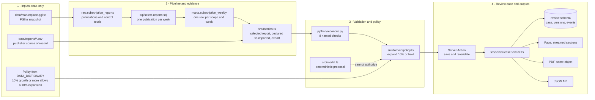
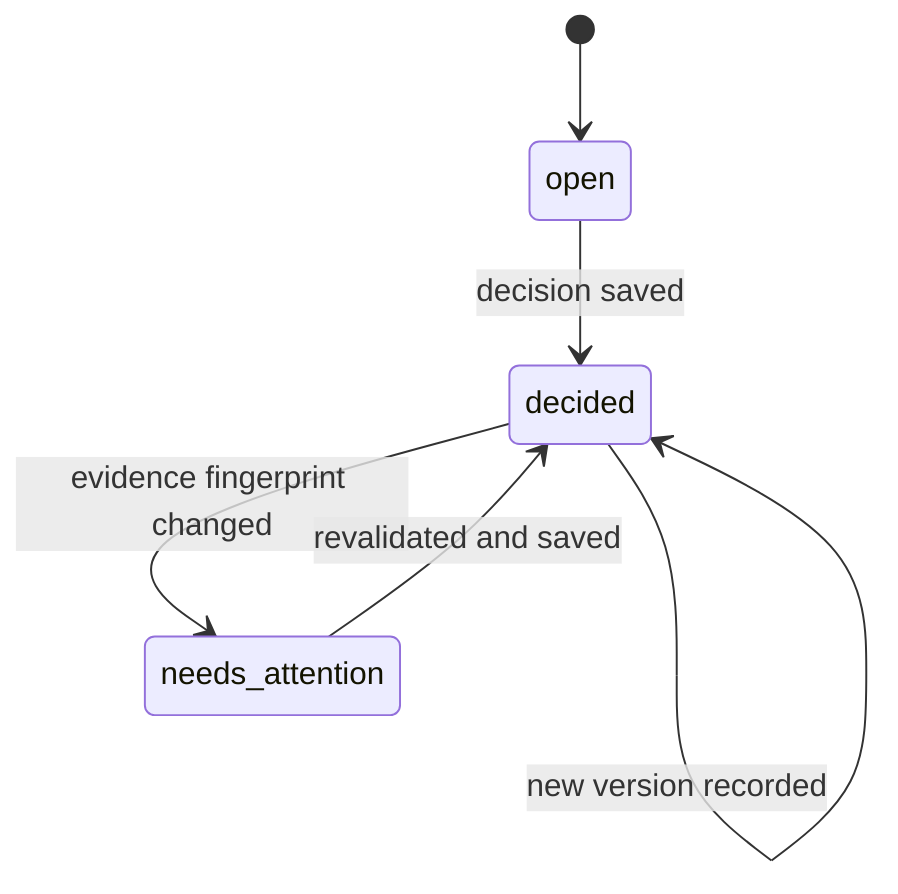

# Architecture

The same picture as `architecture.svg`, in Mermaid so it renders on the repository page and stays
easy to edit.

Case lifecycle:

Two boundaries matter when reading the diagram:

- Everything in bands 2 and 3 runs on the server only; the browser never sees SQL, the database or the
  Python process. The model provider is inside that boundary too, and it can only propose.
- A decision is pinned to an evidence fingerprint. When the publication the decision was taken on
  changes, the case moves to `needs_attention` and the report withholds the old approval.
